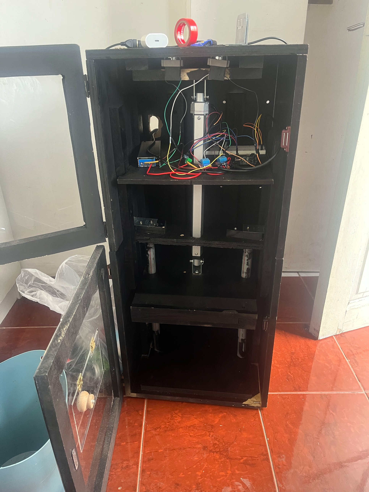
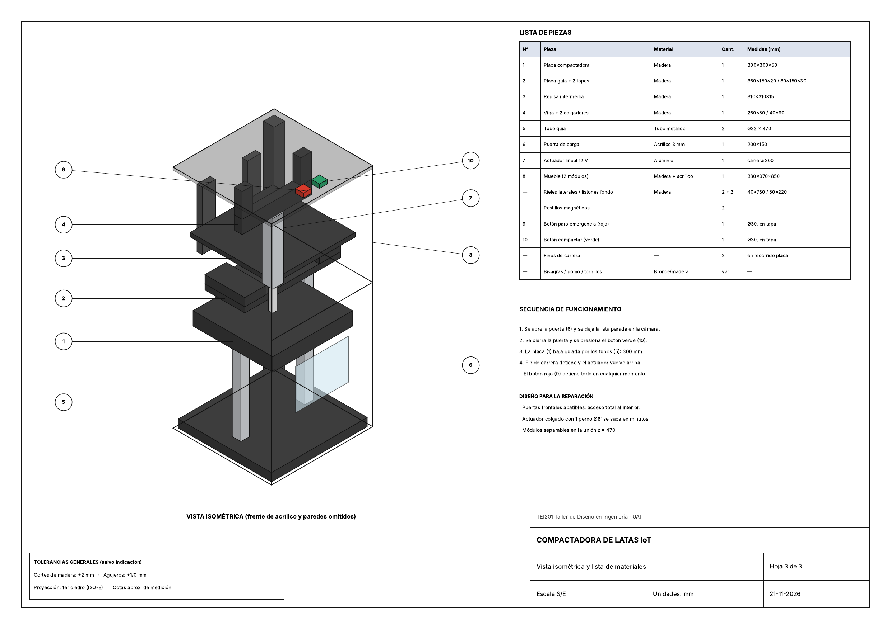
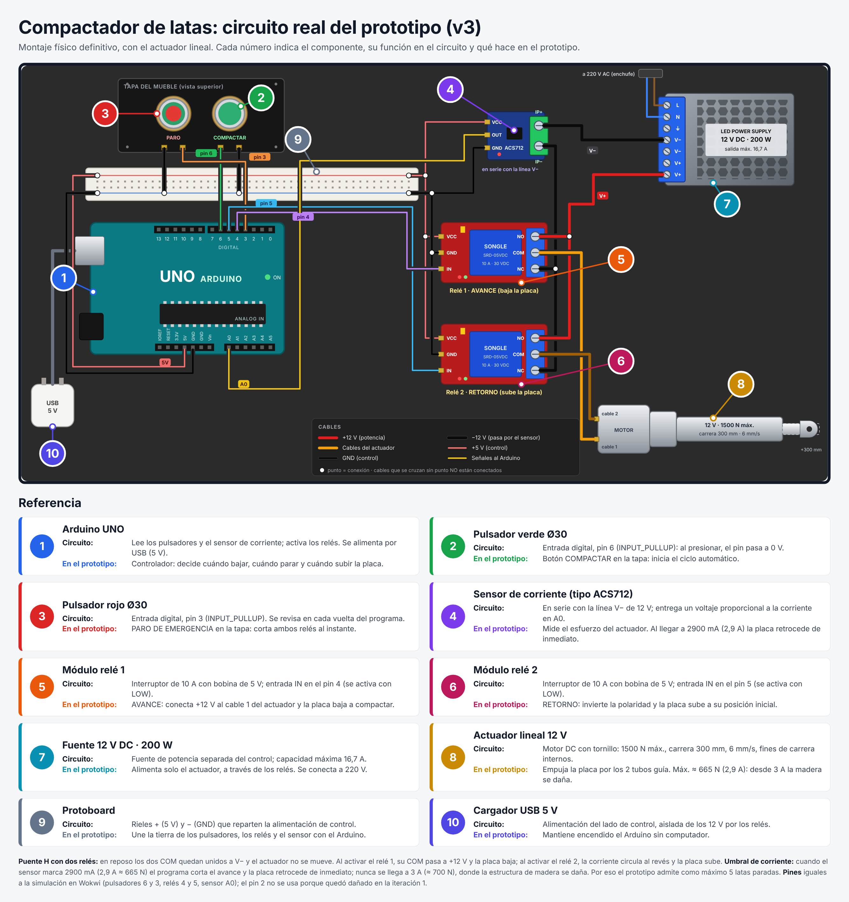

# Recypress — Compactador automático de latas para puntos de reciclaje

<p align="center">
  
  &nbsp;
  
</p>

### Información del Equipo
- **Integrantes:**
  - Santiago Harb - Prototipado y código
  - Claudio Lagos - Diseño real
  - Sebastián Miranda - Diseño real
  - Elio Ramírez - Prototipado y código
  - Agustín Riquelme - Diseño real
- **Curso:** Taller de Diseño (TEI201), Sección IV — Universidad Adolfo Ibáñez
- **Profesor:** Benjamín Gutiérrez

- **ODS seleccionado:** ODS 12 - Producción y consumo responsables
- **Problema a resolver:** desaprovechamiento de la capacidad de los contenedores de reciclaje debido al gran volumen que ocupan los residuos depositados sin compactar (latas, botellas PET y cartón). Caso de estudio del informe: Punto Verde Líder Quilín (Peñalolén). Usuarios del piloto según la presentación: comunidad de la UAI, escalable a puntos de reciclaje comunes.

### Descripción del Proyecto
Contenedor de reciclaje con compactación automática de latas. El usuario deja las latas **paradas** en la cámara, cierra la puerta de carga y presiona el **pulsador verde**. Un **actuador lineal de 12 V**, controlado por un **Arduino UNO** mediante dos relés, baja una placa de madera que aplasta las latas. Un **sensor de corriente** mide el esfuerzo del motor: cuando llega al umbral de **2900 mA (2,9 A ≈ 665 N)** la placa retrocede de inmediato y vuelve a subir sola, sin llegar nunca a 3 A. El **pulsador rojo** es un paro de emergencia que funciona en cualquier momento.

Compactar cada lata reduce el volumen que ocupa: una lata llevada a cerca del 30 % de su altura permite guardar unas **tres veces más latas** en el mismo espacio. El proyecto mejora un precedente del ramo Taller de Introducción a la Ingeniería (2.° semestre 2025), que usaba un compactador manual.

### Estado del Proyecto
- **Versión actual:** v3.0 (prototipo final)
- **Última actualización:** 22 de noviembre de 2026
- **Estado:** prototipo construido y funcionando con ciclo automático, límite de fuerza y paro de emergencia. Capacidad limitada a 5 latas paradas por la resistencia de la estructura de madera (ver abajo). Testing con usuarios pendiente.

| Iteración | Qué se logró | Detalle |
|---|---|---|
| v1.0 | Control manual del actuador con 2 relés en banco de pruebas | `iteraciones/iteracion_1/` · commit `8b274ca` |
| v2.0 | Ciclo automático simulado en Wokwi y diseño en madera | `iteraciones/iteracion_2/` |
| v3.0 | Prototipo construido, sensor de corriente, refuerzos de acero | `iteraciones/iteracion_3/` |

---

## ⚠️ Limitación: estructura de madera

El proyecto tuvo una limitación importante causada por el **material de la estructura, que es de madera**. Los problemas fueron sobre todo de hardware: el material resistía poco.

- Cuando la corriente del actuador **superaba los 3 A**, la fuerza también superaba lo que soportaba la estructura y **esta tendía a romperse**. Con 3 A el actuador ejerce aproximadamente **700 N** (F ≈ 350 N/A · (I − 1 A); el equivalente al peso de unos 71 kg), menos de la mitad de los 1500 N que puede dar.
- Por eso el proyecto se limitó a **un máximo de 5 latas paradas** por ciclo: con más latas, la corriente pasaba los 3 A.
- En esta versión **no es posible usar latas acostadas**: acostadas se vuelven más duras y superan la resistencia del prototipo.
- Hubo que **reforzar el techo y el piso con escuadras de acero**, y el programa tiene un **umbral de 2900 mA (2,9 A)**: al alcanzarlo, la placa retrocede de inmediato. Así queda un margen de 0,1 A antes de los 3 A en que la máquina se daña.

Cálculo de la fuerza, explicación física y recomendaciones: [`testing/reportes/pruebas_carga_v3.md`](testing/reportes/pruebas_carga_v3.md).

---

## Circuito real



Conexiones completas y simulación en Wokwi: [`hardware/esquemas/`](hardware/esquemas/README.md).

---

## Estructura del Repositorio
```
├── hardware/          # Circuito real, simulación, conexiones, BOM, fotos e instrucciones de ensamble
├── software/          # Programa v3, diagnóstico, pruebas en PC y manual de operación
├── diseno_3d/         # Planos v3 (PDF + imágenes) y modelo Fusion 360 de la v1
├── testing/           # Pruebas de carga, estimación de fuerza y evidencias
├── documentacion/     # Reporte final y presentación
└── iteraciones/       # Historial v1 → v2 → v3 (con fotos, código y conexiones de la v1)
```

---

## Inicio Rápido

### Requisitos previos
- Arduino IDE 2.x
- Arduino UNO, 2 módulos de relé de 5 V, sensor de corriente tipo ACS712, actuador lineal de 12 V, fuente de 12 V (200 W) y cargador USB de 5 V
- Mueble según `diseno_3d/planos/planos_v3.pdf`, con las escuadras de acero en el techo y el piso

### Instalación
1. Clonar el repositorio.
2. No se requieren librerías externas.
3. Armar el circuito siguiendo [`hardware/instrucciones_ensamble.md`](hardware/instrucciones_ensamble.md) y hacer la prueba en seco con `software/src/diagnostico/diagnostico.ino`.
4. Abrir `software/src/compactador_v3/compactador_v3.ino`, ajustar `SENSIBILIDAD_V_POR_A` a la versión del sensor, seleccionar **Arduino UNO** y subir el código.
5. Operar según [`software/docs/README.md`](software/docs/README.md): **máximo 5 latas paradas**, pulsador verde para compactar, rojo para detener.

---

## Checklist de Entrega

### Hardware ✓
- [x] Esquema del circuito real con el actuador (`hardware/esquemas/circuito_real_v3.png`) y simulación en Wokwi
- [x] Tabla de conexiones completa (`hardware/esquemas/README.md`)
- [ ] BOM completo — *componentes y piezas listados; faltan precios y proveedores*
- [x] Fotos del prototipo final (`hardware/fotos/`) y de las versiones anteriores

### Software ✓
- [x] Código comentado (`software/src/compactador_v3/compactador_v3.ino`)
- [x] Librerías documentadas (no usa librerías externas)
- [x] Manual de instalación y de operación
- [x] Pruebas de la lógica en PC (`software/pruebas_pc/`)

### Diseño 3D ✓
- [x] Planos técnicos (`diseno_3d/planos/planos_v3.pdf`: ensamble, despiece, isométrica y lista de piezas)
- [x] Modelo Fusion 360 de la v1 (`diseno_3d/compactador_v1.f3z`)
- [ ] Modelo 3D de la v3 con la electrónica y las escuadras de acero
- [ ] Renders de alta calidad

### Testing ✓
- [x] Pruebas de carga y limitaciones (`testing/reportes/pruebas_carga_v3.md`)
- [x] Estimación cuantitativa de fuerza según corriente (`testing/datos/`)
- [ ] Reporte de testing con usuarios (mín. 5)
- [ ] Video del ciclo completo

### Documentación ✓
- [x] Avance N°1 (en el historial de git)
- [ ] Reporte final (máx. 15 páginas)
- [ ] Presentación (10 min)

---

## Licencia
Este proyecto es desarrollado como parte del curso TEI201 - Facultad de Ingeniería y Ciencias - Universidad Adolfo Ibáñez.
