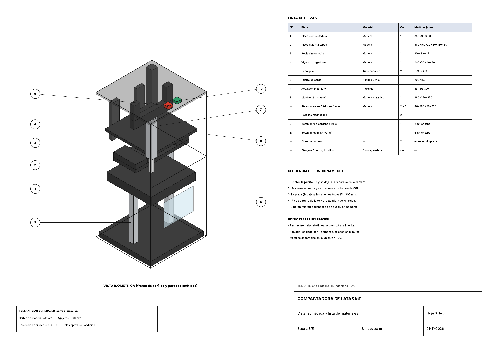

# Diseño 3D y Planos - Documentación

## Contenido

| Carpeta / archivo | Contenido | Versión |
|---|---|---|
| `planos/` | **Planos del prototipo final** (PDF de 3 hojas + imágenes): ensamble, despiece, isométrica y lista de piezas | v3 |
| `compactador_v1.f3z` | Modelo de Fusion 360 de la v1 (estructura en acero, 450 × 450 × 1000 mm) | v1 |
| `fusion360/README.md` | Propiedades físicas por pieza del modelo v1 y observaciones de revisión | v1 |

---

## Diseño definitivo (v3)

**Unidades:** milímetros (mm) · **Escala de los planos:** 1:5 (detalles 1:3 y 1:2,5)

| Parámetro | Valor |
|---|---|
| Dimensiones externas | 380 × 370 × 850 mm |
| Construcción | Mueble de madera pintada de negro en 2 módulos atornillados (470 + 380 mm) |
| Frente | Puertas de acrílico con marco negro y pestillo magnético; puerta de carga de acrílico 3 mm (200 × 150 mm) |
| Mecanismo | Actuador lineal colgado de una viga (perno Ø8) que empuja una placa de madera de 300 × 300 × 50 mm por 2 tubos guía de Ø32 |
| Carrera útil | 300 mm (alto de la cámara: la lata cabe parada) |
| Mandos | Pulsadores Ø30 en la tapa: rojo = paro de emergencia, verde = compactar |
| Refuerzos | Rieles laterales, 2 listones de fondo y **escuadras de acero en el techo y el piso** |

### Componentes incluidos en los planos
- ✅ Mueble exterior completo, puertas y puerta de carga
- ✅ Actuador lineal en su posición, con su viga y perno de montaje
- ✅ Placa compactadora, tubos guía, placa guía y repisa intermedia
- ✅ Pulsadores y paso de cables en la tapa
- ✅ Posición extendida de la placa (línea roja discontinua)
- ⚠️ La electrónica (Arduino, relés, sensor, fuente) está sobre la repisa intermedia, pero no está dibujada en los planos: ver fotos en `hardware/fotos/` y el circuito en `hardware/esquemas/`
- ⚠️ Las escuadras de acero se agregaron después de las pruebas y no están dibujadas

---

## Evolución del diseño

| Aspecto | v1 (Fusion 360) | v3 (prototipo construido) |
|---|---|---|
| Material | Acero en todas las piezas (modelo) | Madera, acrílico, tubos guía y escuadras de acero |
| Dimensiones | 450 × 450 × 1000 mm | 380 × 370 × 850 mm |
| Peso | 135,4 kg (modelo en acero) | Mucho menor; [completar con medición] |
| Placa compactadora | Acero macizo 380 × 380 × 15 mm | Madera 300 × 300 × 50 mm |
| Guías | 2 ejes Ø16 | 2 tubos Ø32 |
| Mandos | No modelados | Pulsadores Ø30 en la tapa |
| Reparación | — | Puertas abatibles, actuador con un solo perno, módulos separables |

**Consecuencia del cambio de material:** la madera hizo el prototipo fabricable y liviano, pero limitó la fuerza útil a ≈ 700 N (3 A) frente a los 1500 N del actuador. Detalle en `testing/reportes/pruebas_carga_v3.md`.

---

## Consideraciones de diseño

### Funcionales
- [x] Acceso al USB y a la alimentación (electrónica en la repisa, detrás de la puerta frontal superior)
- [x] Protección de la electrónica (separada de la cámara de compactación por la repisa intermedia)
- [x] Fácil acceso para mantenimiento (puertas frontales abatibles)
- [ ] Ventilación de la fuente de 12 V (revisar si la repisa queda cerrada)
- [ ] Resistencia de la estructura a la fuerza completa del actuador (limitada a ≈ 700 N)

### Fabricación
- Cortes de madera con tolerancia de ±2 mm; agujeros +1/0 mm.
- Holgura radial de 1 mm entre la placa (agujeros Ø34) y los tubos guía (Ø32).
