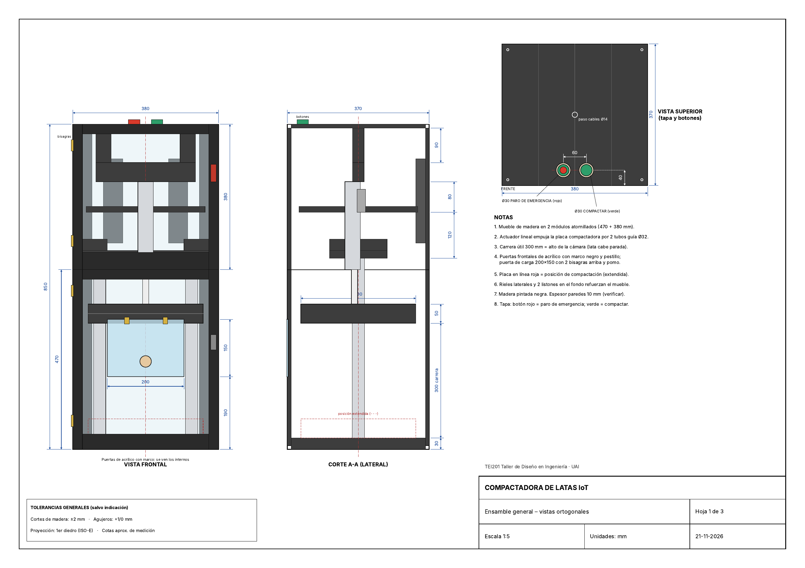
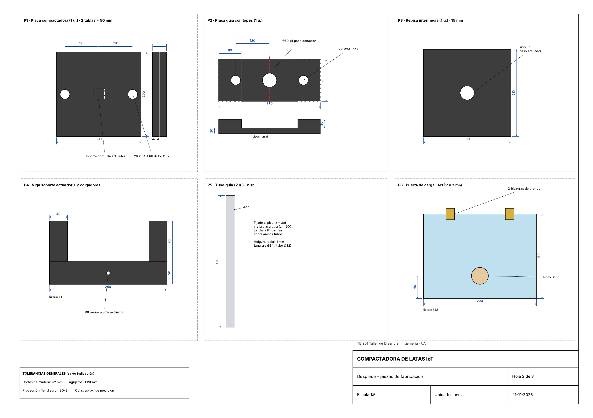
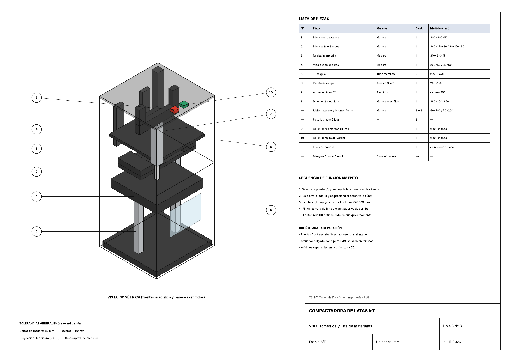

# Planos Técnicos (v3.0)

## Archivos

| Archivo | Contenido |
|---|---|
| `planos_v3.pdf` | Juego completo de 3 hojas A3 (21-11-2026) |
| `planos_v3_hoja1_ensamble.png` | Hoja 1: ensamble general, vistas ortogonales (escala 1:5) |
| `planos_v3_hoja2_despiece.png` | Hoja 2: despiece, piezas de fabricación P1 a P6 (escala 1:5) |
| `planos_v3_hoja3_isometrica_bom.png` | Hoja 3: vista isométrica, lista de piezas y secuencia de funcionamiento |

**Datos generales:** unidades en mm · proyección del 1er diedro (ISO-E) · tolerancias: cortes de madera ±2 mm, agujeros +1/0 mm · cotas aproximadas de medición del prototipo construido.

---

## Hoja 1: ensamble general

- **Vista frontal, corte A-A (lateral) y vista superior** de la tapa con los pulsadores.
- Mueble de **380 × 370 × 850 mm** en 2 módulos atornillados (470 + 380 mm).
- **Carrera útil de 300 mm** = alto de la cámara: la lata cabe parada. La línea roja discontinua marca la posición extendida (de compactación).
- Tapa: pulsadores de Ø30 separados 60 mm (rojo = paro de emergencia, verde = compactar) y paso de cables de Ø14.
- Puerta de carga de 200 × 150 mm con 2 bisagras arriba y pomo.

## Hoja 2: despiece

| Pieza | Descripción | Medidas clave |
|---|---|---|
| P1 | Placa compactadora (2 tablas) | 300 × 300 × 50; 2 agujeros Ø34 +1/0 para los tubos; soporte de horquilla del actuador al centro |
| P2 | Placa guía con topes | 360 × 150 × 20; topes de 80 × 30; paso del actuador Ø50 ±1; 2 agujeros Ø34 |
| P3 | Repisa intermedia | 310 × 310 × 15; paso del actuador Ø50 ±1 |
| P4 | Viga soporte del actuador + 2 colgadores | 260 × 50; colgadores 40 × 90; perno pivote Ø8 |
| P5 | Tubo guía (2 u.) | Ø32 × 470; fijado al piso (z = 30) y a la placa guía (z = 500); holgura radial 1 mm |
| P6 | Puerta de carga | Acrílico 3 mm, 200 × 150; pomo Ø30; 2 bisagras de bronce |

## Hoja 3: vista isométrica y lista de piezas

**Secuencia de funcionamiento (según planos):**
1. Se abre la puerta de carga (6) y se deja la lata parada en la cámara.
2. Se cierra la puerta y se presiona el pulsador verde (10).
3. La placa (1) baja guiada por los tubos (5): 300 mm.
4. El fin de carrera detiene la placa y el actuador vuelve arriba. El pulsador rojo (9) detiene todo en cualquier momento.

**Diseño para la reparación:** puertas frontales abatibles (acceso total al interior), actuador colgado de un solo perno de Ø8 (se saca en minutos) y módulos separables en la unión z = 470.

---

## Notas sobre el prototipo construido

- **Límite de carga.** En las pruebas, la estructura de madera cedió sobre ≈ 700 N (3 A). El programa limita la fuerza y se compactan como máximo **5 latas paradas** por ciclo; las latas acostadas no se pueden usar (ver `testing/reportes/pruebas_carga_v3.md`).
- **Refuerzos no dibujados.** Después de las pruebas se agregaron **escuadras de acero** en el techo y en el piso del mueble (fotos `hardware/fotos/v3_08_*` y `v3_09_*`). Una revisión de los planos debería incluirlas.
- **Fin de la compactación.** En el programa v3, la placa también se detiene antes del fondo cuando la corriente llega a 3 A.
