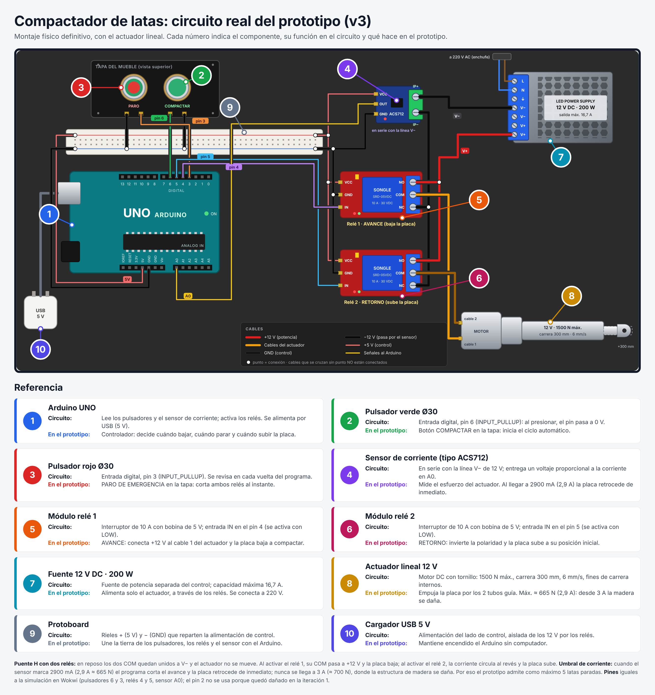

# Hardware - Documentación (v3.0)

## Contenido

| Carpeta / archivo | Contenido |
|---|---|
| `esquemas/` | Circuito real del prototipo (imagen numerada), simulación en Wokwi y tabla de conexiones |
| `bom/` | Lista de materiales: electrónica, estructura de madera y refuerzos |
| `fotos/` | Fotografías del prototipo final |
| `instrucciones_ensamble.md` | Armado del circuito y del mueble, pruebas en seco y con 12 V |

Las instrucciones y conexiones de la v1 están en `iteraciones/iteracion_1/`.

---

## Componentes principales

| N° | Componente | Función |
|---|---|---|
| 1 | **Arduino UNO** | Lee los pulsadores y el sensor; decide cuándo bajar, parar y subir la placa |
| 2 | **Pulsador verde Ø30** (tapa) | COMPACTAR: inicia el ciclo automático |
| 3 | **Pulsador rojo Ø30** (tapa) | PARO DE EMERGENCIA: apaga ambos relés al instante |
| 4 | **Sensor de corriente tipo ACS712** | Mide la corriente del actuador; a 3 A (≈ 700 N) se detiene la compactación |
| 5 | **Módulo relé 1** (Songle SRD-05VDC-SL-C) | AVANCE: la placa baja |
| 6 | **Módulo relé 2** (Songle SRD-05VDC-SL-C) | RETORNO: la placa sube. Junto con el relé 1 forma un puente H que invierte el sentido del motor |
| 7 | **Fuente 12 V DC, 200 W (16,7 A)** | Potencia del actuador, separada del control |
| 8 | **Actuador lineal 12 V** (ARF03-12-A1-405-300-C11) | Empuja la placa compactadora: 1500 N máx., carrera 300 mm, 6 mm/s |
| 9 | **Protoboard** | Reparte 5 V y GND a pulsadores, relés y sensor |
| 10 | **Cargador USB 5 V** | Alimenta el Arduino sin computador |

### Estructura (ver `diseno_3d/planos/`)

- **Mueble de madera pintada de negro** en dos módulos atornillados (470 + 380 mm), 380 × 370 × 850 mm, con puertas frontales de acrílico y una puerta de carga de 200 × 150 mm.
- **Placa compactadora de madera** (300 × 300 × 50 mm) guiada por **2 tubos de Ø32 mm**.
- **Actuador colgado de una viga** en el techo, con un perno pivote de Ø8 mm.
- **Escuadras de acero** en el techo y en el piso, agregadas porque la madera cedía con la fuerza del actuador.

---

## ⚠️ Limitación del prototipo: estructura de madera

El material de la estructura limitó el proyecto. Sobre **3 A** de corriente, la fuerza del actuador (**≈ 700 N**) superaba lo que soportaba el mueble de madera y este tendía a romperse. Por eso:

- El programa **corta a 3 A** (`CORRIENTE_LIMITE_A` en `compactador_v3.ino`).
- Se compactan **como máximo 5 latas, siempre paradas**. Con más latas la corriente superaba los 3 A.
- **No se pueden usar latas acostadas:** acostadas se vuelven más duras de aplastar y superan la resistencia del prototipo.
- Se reforzaron **el techo y el piso con escuadras de acero**.

El actuador (1500 N) y la fuente (16,7 A) tienen capacidad de sobra: el límite es la estructura. El detalle y el cálculo de la fuerza están en `testing/reportes/pruebas_carga_v3.md`.

---

## Especificaciones técnicas

| Parámetro | Valor |
|---|---|
| Alimentación de control | 5 V por USB (cargador) |
| Alimentación de potencia | 12 V DC, fuente LED de 200 W (16,7 A máx.), entrada 220 V AC |
| Actuador | 12 V DC, carrera 300 mm, 1500 N máx., 6 mm/s, ciclo de trabajo 10 %, fines de carrera internos |
| Corriente de trabajo | ≈ 1 A en vacío; **3 A máximo** permitido por el programa |
| Fuerza de compactación | ≈ 700 N máximo (estimada; ver pruebas de carga) |
| Capacidad por ciclo | Máximo 5 latas paradas |
| Duración de un ciclo | ≈ 1 a 1,7 min (bajar y subir 300 mm a 6 mm/s) |
| Dimensiones del mueble | 380 × 370 × 850 mm |
| Material | Madera pintada, acrílico de 3 mm, tubos guía Ø32, escuadras de acero |

---

## Precauciones

- ⚠️ Desconectar la fuente de 12 V y el USB antes de mover cualquier cable.
- ⚠️ Ningún cable de 12 V debe tocar la protoboard, el Arduino ni sus cables.
- ⚠️ La fuente se conecta a **220 V**: mantener cerrada su bornera (tapa transparente) y no tocar los bornes L y N con la fuente enchufada.
- ⚠️ Mantener las manos fuera de la cámara mientras la placa se mueve. El pulsador rojo detiene todo.
- ⚠️ No cargar más de 5 latas ni latas acostadas.
- ⚠️ Respetar el ciclo de trabajo del actuador (10 %): unos 9 minutos de descanso por cada minuto de uso.
- ⚠️ Recortar los hilos de cobre sueltos en las borneras para evitar cortocircuitos entre tornillos vecinos.

---

## Solución de problemas

| Problema | Posible causa | Solución |
|---|---|---|
| Los relés no responden a los pulsadores | Pines del código distintos del cableado | Revisar la tabla de pines de `software/src/README.md` |
| Un relé se activa solo, sin presionar | Señal y tierra del pulsador en el mismo borne o cable pelado tocando GND | Revisar el cableado del pulsador con `diagnostico.ino` |
| Luz verde del relé encendida en reposo | Módulo configurado en lógica inversa distinta | Revisar el jumper H/L del módulo y las constantes `RELE_ENCENDIDO` / `RELE_APAGADO` |
| Luz roja del relé o del sensor apagada | Sin 5 V: cable VCC/GND defectuoso | Reemplazar los cables y verificar 5V → riel rojo |
| Relés hacen "clic" pero el actuador no se mueve | Fuente desenchufada, cable suelto en COM o fuente sin salida | Medir 12 V en la bornera de la fuente y entre los COM (ver instrucciones, paso D3) |
| El actuador se mueve solo al enchufar la fuente | Puentes cruzados (positivo en NO en un relé y en NC en el otro) | Desenchufar; misma posición = mismo polo en ambos relés |
| El actuador no se mueve en un sentido | Ya está en su extremo de recorrido | Es normal: el fin de carrera interno lo detiene |
| La placa se detiene apenas parte | Lectura del sensor mal calibrada | Ver `software/docs/README.md` |
| La placa nunca se detiene por límite | El sensor no está en serie con la línea de 12 V | Revisar que V− pase por los bornes IP+ / IP− del sensor |
| La madera cruje o se deforma | Demasiadas latas, latas acostadas o límite de corriente aumentado | Máximo 5 latas paradas; no subir `CORRIENTE_LIMITE_A`; revisar escuadras |
| El multímetro marca 12 V solo por un instante | Las puntas apenas rozan el cobre | Medir apoyando la punta en la cabeza del tornillo |
