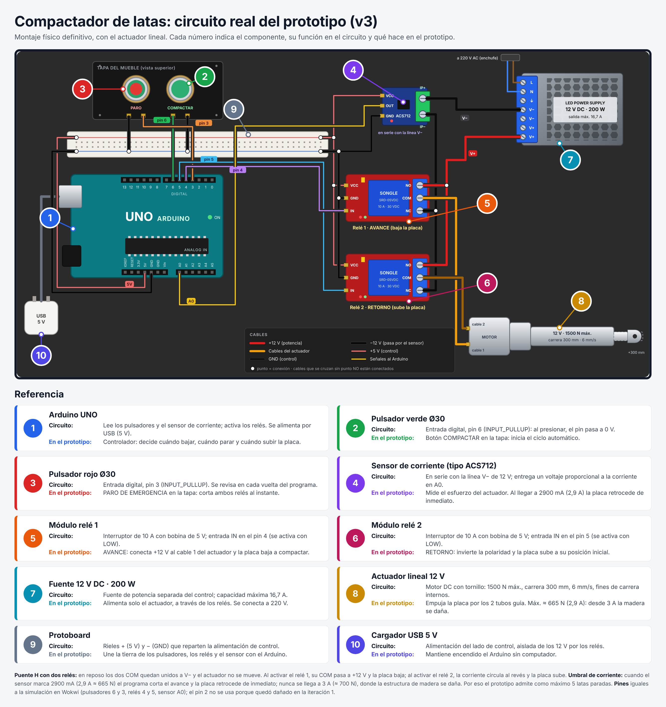
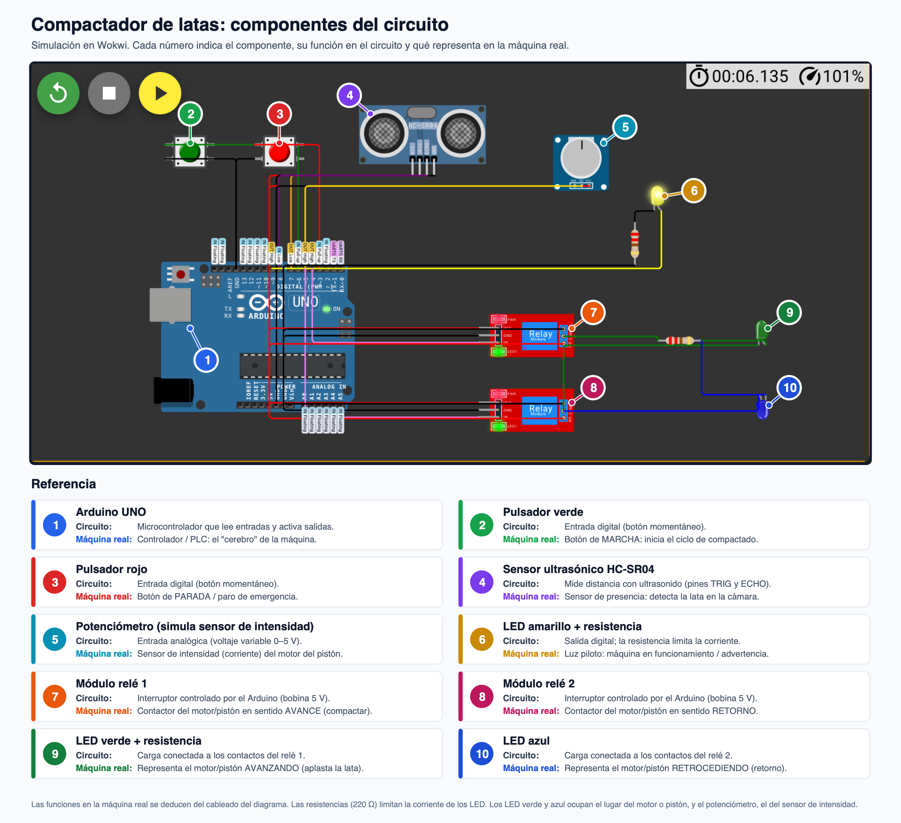

# Esquemas de Circuito (v3.0)

## Archivos

| Archivo | Contenido |
|---|---|
| `circuito_real_v3.png` | **Circuito real del prototipo final**, con el actuador lineal, la fuente de 12 V y el sensor de corriente. Cada componente está numerado y explicado |
| `simulacion_wokwi_v3.png` | Simulación del control en Wokwi: el potenciómetro reemplaza al sensor de corriente y los LED verde y azul reemplazan al actuador |
| `fuente/` | Scripts que dibujan `circuito_real_v3.png` (para editar el diagrama si cambia el cableado): `python3 generar_circuito_real_v3.py` crea el HTML y `python3 render_png.py` lo convierte a PNG con Chrome |

**Pendiente:** exportar desde Wokwi el `diagram.json`, el código de la simulación y el enlace del proyecto (`wokwi_link.txt`).

---

## Circuito real

## Simulación en Wokwi

### Diferencias entre la simulación y el montaje real

| En Wokwi | En el prototipo | Motivo |
|---|---|---|
| Potenciómetro en A0 | Sensor de corriente tipo ACS712 en A0 | Wokwi no simula el consumo del motor; el potenciómetro permite variar a mano la "corriente" |
| LED verde (relé 1) y LED azul (relé 2) | Actuador lineal de 12 V conectado a los COM de ambos relés | Los LED muestran qué sentido de giro se activaría |
| Pulsadores táctiles | Pulsadores Ø30 en la tapa del mueble | Mismos pines (6 y 3) |
| Sensor ultrasónico HC-SR04 (pines 7 y 8) y LED piloto amarillo (pin 9) | No se montaron | No aparecen en el montaje final ni en la lista de piezas de los planos v3; el ciclo se inicia con el pulsador verde |

---

## Conexiones v3.0

### Lado de control (5 V)

| Desde | Hasta | Función |
|---|---|---|
| Cargador USB 5 V | Puerto USB del Arduino | Alimenta el Arduino y todo el lado de control |
| Arduino **5V** | Riel rojo (+) de la protoboard | Reparte 5 V |
| Arduino **GND** | Riel azul (−) de la protoboard | Tierra común |
| Pulsador verde, borne 1 | Arduino **pin 6** | Señal COMPACTAR |
| Pulsador verde, borne 2 | Riel (−) | Tierra del pulsador |
| Pulsador rojo, borne 1 | Arduino **pin 3** | Señal PARO DE EMERGENCIA |
| Pulsador rojo, borne 2 | Riel (−) | Tierra del pulsador |
| Relé 1 y relé 2 **VCC** | Riel (+) | Energía de las bobinas |
| Relé 1 y relé 2 **GND** | Riel (−) | Tierra de los relés |
| Relé 1 **IN** | Arduino **pin 4** | Orden de AVANCE |
| Relé 2 **IN** | Arduino **pin 5** | Orden de RETORNO |
| Sensor **VCC** / **GND** | Riel (+) / riel (−) | Energía del sensor |
| Sensor **OUT** | Arduino **A0** | Voltaje proporcional a la corriente |

### Lado de potencia (12 V): puente H con dos relés y sensor en serie

| Desde | Hasta | Función |
|---|---|---|
| Red 220 V (L, N) | Fuente: bornes L y N | Entrada de la fuente |
| Fuente **V+** | **NO** del relé 1 y **NO** del relé 2 (puente) | +12 V |
| Fuente **V−** | Sensor de corriente, borne IP+ | La corriente de vuelta pasa por el sensor |
| Sensor, borne IP− | **NC** del relé 1 y **NC** del relé 2 (puente) | −12 V |
| **COM** del relé 1 | Cable 1 del actuador | Salida al motor |
| **COM** del relé 2 | Cable 2 del actuador | Salida al motor |

| Tornillo | Relé 1 | Relé 2 |
|---|---|---|
| **NO** | +12 V | +12 V (puente) |
| **COM** (medio) | Cable 1 del actuador, solo | Cable 2 del actuador, solo |
| **NC** | −12 V (desde el sensor) | −12 V (puente) |

**Regla:** cada posición (NO, COM, NC) debe tener el mismo polo en ambos relés.

### Por qué funciona

- **En reposo**, los dos COM tocan el NC (−12 V): los dos extremos del actuador están al mismo voltaje, no circula corriente y el actuador queda quieto.
- **Relé 1 activo** (pin 4 en LOW): su COM pasa a +12 V. La corriente va de +12 V → cable 1 → motor → cable 2 → NC del relé 2 → sensor → V−. La placa **baja**.
- **Relé 2 activo** (pin 5 en LOW): la corriente circula al revés por el motor y vuelve por el NC del relé 1 → sensor → V−. La placa **sube**.
- **El sensor mide en los dos sentidos.** Como está en la línea de retorno común (V−), toda la corriente del actuador pasa por él, suba o baje la placa. Medir en V+ daría el mismo valor; en el montaje real quedó en V−.
- Si el actuador se mueve al revés, se intercambian entre sí los dos cables del actuador en los COM.

---

## Notas de diseño

- **Dos alimentaciones separadas.** El cargador USB (5 V) alimenta el Arduino, las bobinas de los relés y el sensor. La fuente de 12 V alimenta solo el actuador, a través de los contactos de los relés. Dentro de cada relé y dentro del sensor ambos lados están aislados.
- **La fuente no limita la fuerza.** La fuente entrega hasta 16,7 A; el límite de 3 A lo impone el programa a partir de la lectura del sensor, para proteger la estructura de madera.
- **Contactos de los relés:** 10 A a 30 V DC, suficiente para los 3 A de trabajo.
- Los 12 V nunca deben conectarse al Arduino ni a la protoboard.
