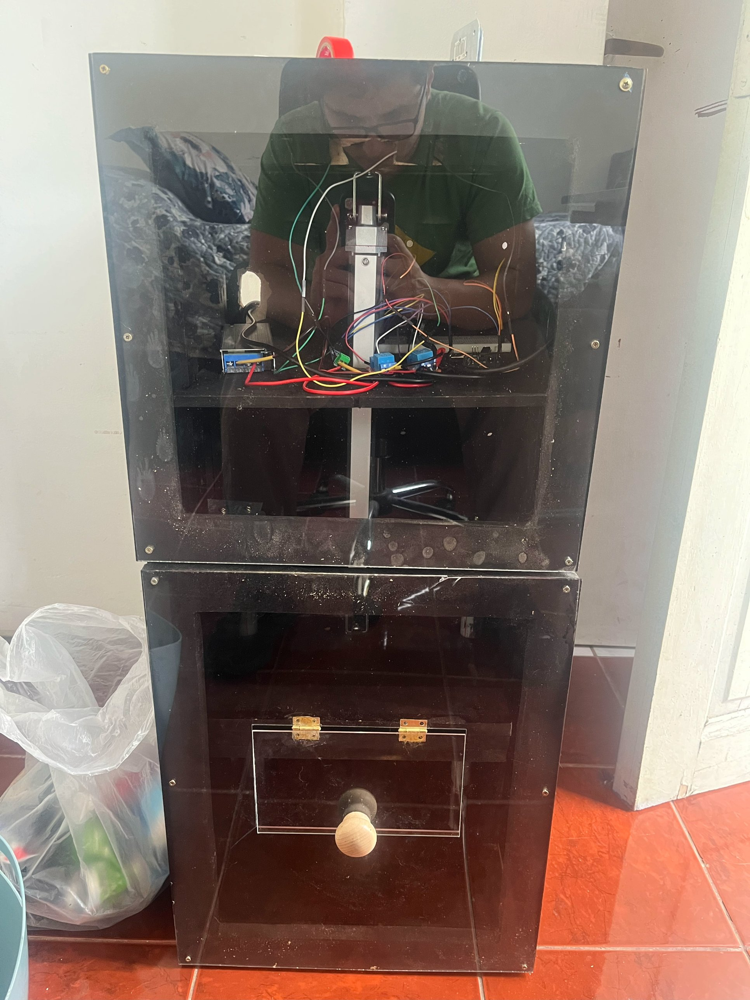
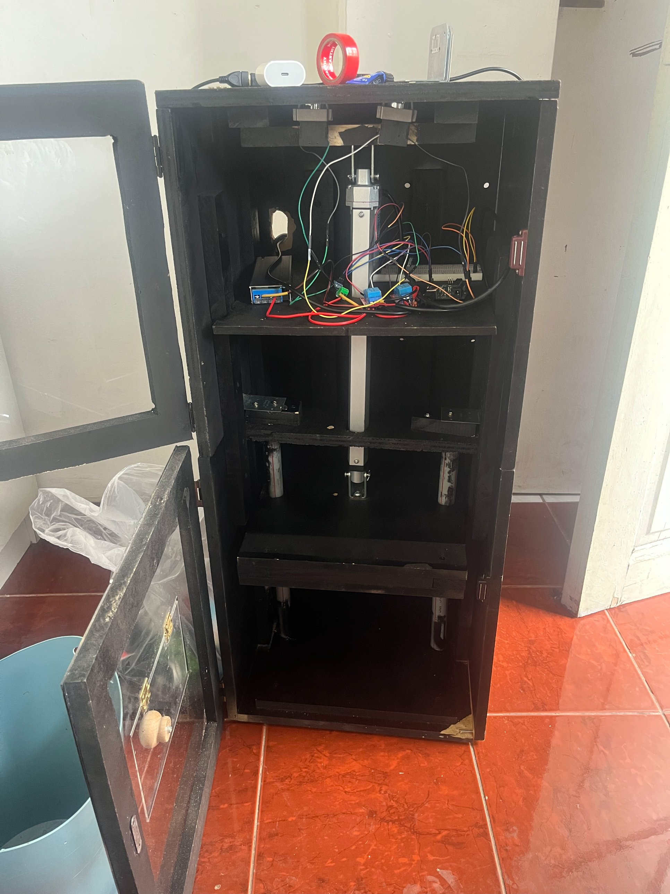
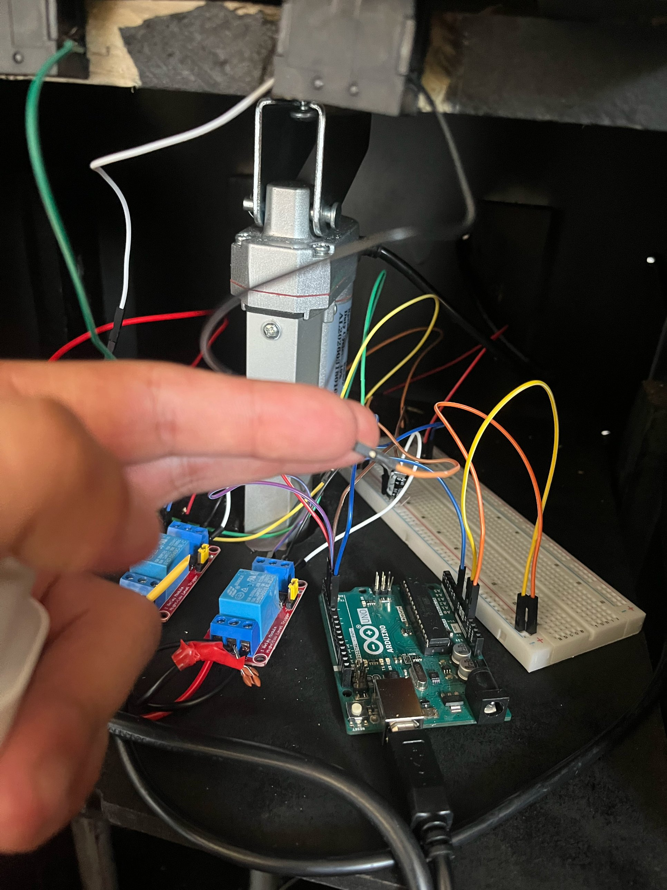
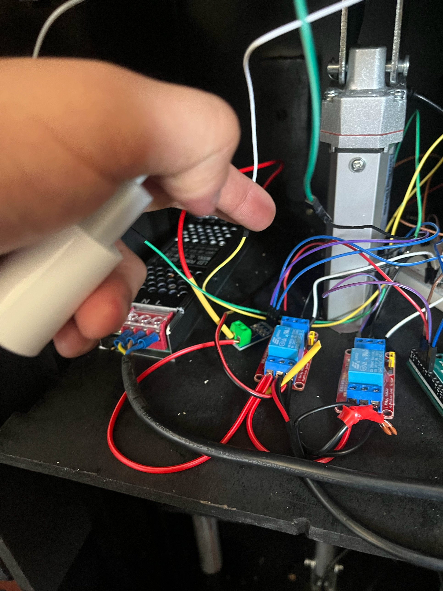
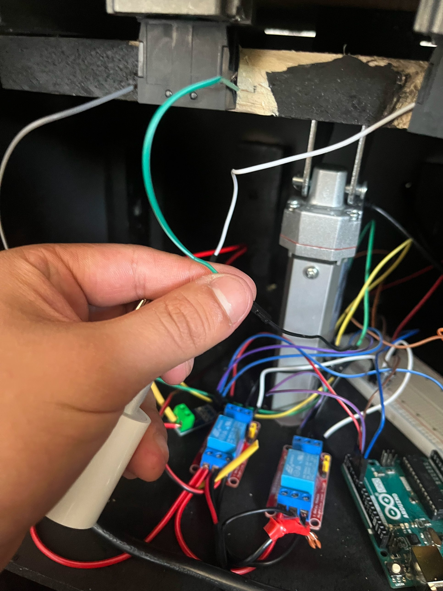
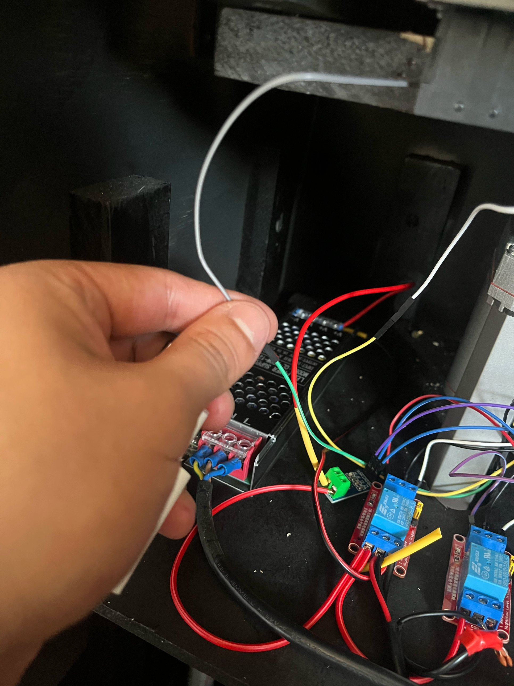
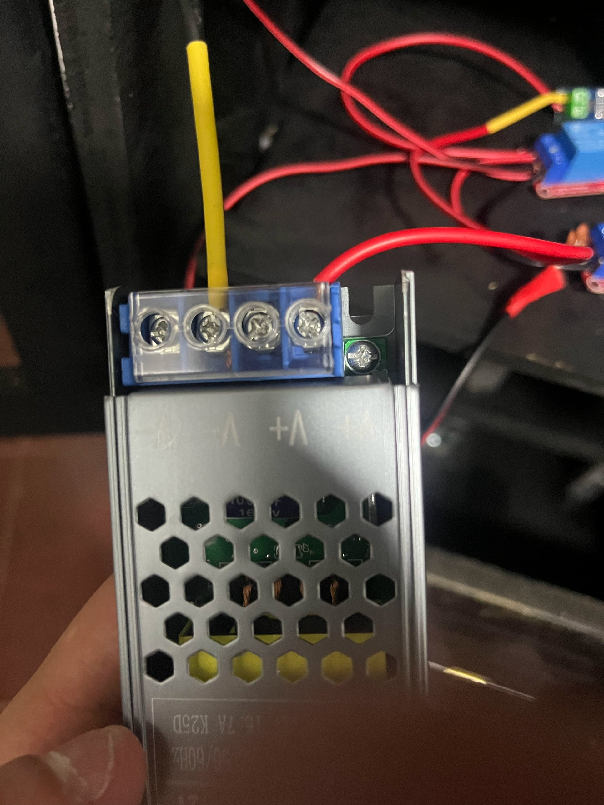
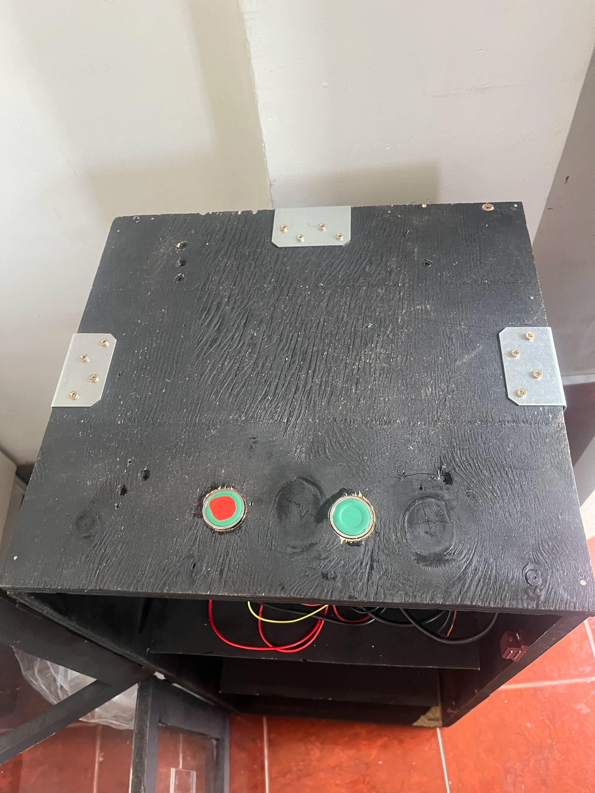
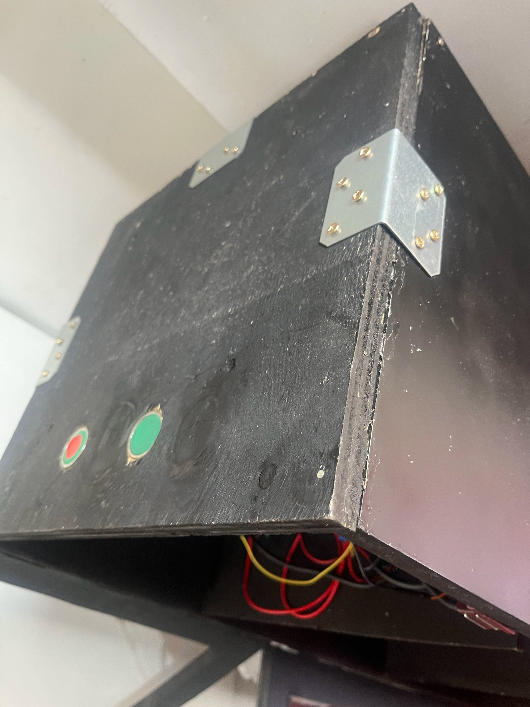

# Fotografías del Prototipo (v3.0)

Fotos del prototipo final. Las fotos del proceso de integración están en `iteraciones/iteracion_3/v3_fotos_proceso/` y las de la v1 en `iteraciones/iteracion_1/v1_fotos/`.

| Archivo | Contenido |
|---|---|
| `v3_01_vista_frontal_cerrado.jpg` | Vista general con las puertas de acrílico cerradas: arriba el módulo del actuador y la electrónica, abajo la cámara con la puerta de carga y su pomo |
| `v3_02_vista_frontal_abierto.jpg` | Mueble abierto: actuador colgado del techo, repisa con la electrónica, placa compactadora y tubos guía en el módulo inferior |
| `v3_03_circuito_interno_actuador.jpg` | Actuador lineal, Arduino UNO, relés y protoboard dentro del mueble |
| `v3_04_fuente_sensor_reles.jpg` | Fuente de 12 V, sensor de corriente (bornera verde) y los dos relés |
| `v3_05_actuador_cables_tapa.jpg` | Fijación superior del actuador y cables de los pulsadores que bajan desde la tapa |
| `v3_06_cableado_fuente_reles.jpg` | Cableado entre la fuente, el sensor de corriente y los relés |
| `v3_07_bornera_fuente_12v.jpg` | Bornera de salida de 12 V de la fuente: cable amarillo (línea V−, hacia el sensor) y cable rojo (V+, hacia los relés) |
| `v3_08_tapa_escuadras_superior.jpg` | Tapa con los pulsadores Ø30 (rojo = paro, verde = compactar) y las escuadras de acero del refuerzo |
| `v3_09_tapa_escuadras_angulo.jpg` | Detalle de las escuadras de acero que unen la tapa con las paredes |

---

## Vista general

| Cerrado | Abierto |
|---|---|
|  |  |

## Electrónica y actuador

| Circuito interno | Fuente, sensor y relés |
|---|---|
|  |  |

| Actuador y cables de la tapa | Cableado de potencia | Bornera de la fuente |
|---|---|---|
|  |  |  |

## Tapa reforzada con escuadras de acero

| Vista superior | Detalle |
|---|---|
|  |  |

---

## Nomenclatura
- Prefijo de versión y número de orden: `v3_01_`, `v3_02_`, …
- Nombre descriptivo en minúsculas, sin tildes ni espacios.
