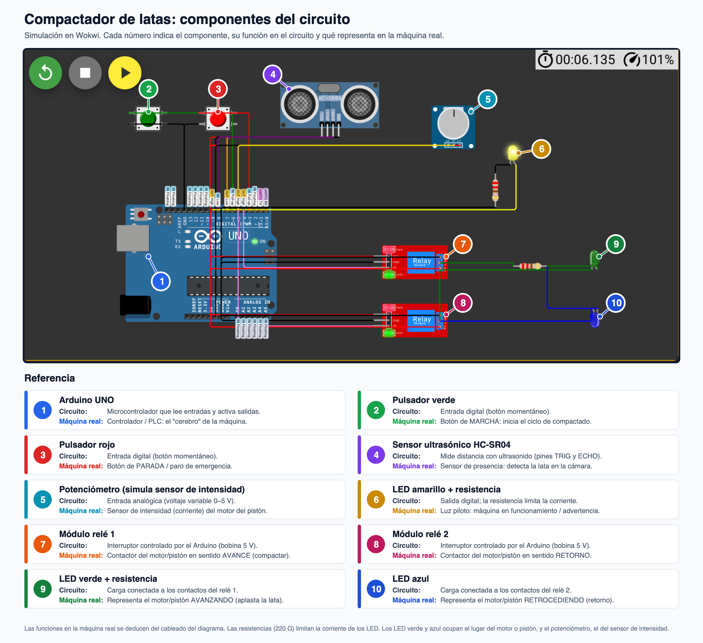

# Iteración 2 - Control automático simulado y paso a la estructura de madera

## Información General

**Fecha:** octubre - noviembre 2026 [completar fecha exacta]  
**Versión:** v2.0  
**Estado:** Prototipo de control en simulación (Wokwi) + diseño de la estructura para fabricar  
**Avance asociado:** Avance #2

---

## Descripción

La v1 demostró que el Arduino puede mover el actuador en ambos sentidos con dos relés, pero solo mientras se mantenía presionado un botón y sin ninguna medición. En esta iteración se diseñó y simuló el **ciclo automático** antes de llevarlo al prototipo real, y se pasó del modelo en acero a una estructura fabricable en madera.

**Objetivos de esta iteración:**
- Pasar del control manual a un ciclo automático de un solo toque.
- Agregar un botón de paro de emergencia.
- Incorporar una medición de la corriente del motor para saber cuánta fuerza hace.
- Probar la lógica en simulación sin arriesgar el actuador ni la fuente.

---

## Simulación en Wokwi

| N° | Componente simulado | Representa en la máquina real |
|---|---|---|
| 1 | Arduino UNO | Controlador del compactador |
| 2 | Pulsador verde (pin 6) | Botón de MARCHA: inicia el ciclo |
| 3 | Pulsador rojo (pin 3) | Botón de PARADA / paro de emergencia |
| 4 | Sensor ultrasónico HC-SR04 (pines 7 y 8) | Sensor de presencia de la lata en la cámara |
| 5 | Potenciómetro (A0) | Sensor de corriente del motor |
| 6 | LED amarillo + resistencia (pin 9) | Luz piloto de funcionamiento |
| 7 | Módulo relé 1 (pin 4) | Contactor de AVANCE |
| 8 | Módulo relé 2 (pin 5) | Contactor de RETORNO |
| 9 | LED verde + resistencia | Motor avanzando (aplasta la lata) |
| 10 | LED azul | Motor retrocediendo |

---

## Cambios Respecto a v1

### Hardware
**Agregado:**
- Medición de corriente (simulada con un potenciómetro) para estimar la fuerza.
- Botón de paro de emergencia.
- Sensor de presencia y luz piloto (solo en la simulación).

**Modificado:**
- Los botones dejan de ser "mantener presionado para mover": el verde inicia un ciclo completo.

**Sin cambios:**
- Pines de los botones (6 y 3) y de los relés (4 y 5), heredados de la v1. El pin 2 sigue sin usarse.

### Software
**Nuevas funcionalidades:**
- Ciclo automático: avance → detención → retorno.
- Detención por corriente (en la simulación, al girar el potenciómetro).
- Paro de emergencia con prioridad sobre todo lo demás.

### Diseño mecánico
- El modelo de Fusion 360 de la v1 tenía acero asignado a todas las piezas (450 × 450 × 1000 mm, 135 kg), aunque el equipo ya había definido construir en madera (lista de materiales de la v1). El diseño se ajustó a un **mueble de madera de 380 × 370 × 850 mm**, con la placa guiada por 2 tubos y el actuador colgado de una viga (planos definitivos en `diseno_3d/planos/`).

---

## Problemas Pendientes (llevados a la v3)

1. **Comprobar la simulación en el prototipo real.**
   - Wokwi no simula el consumo del motor ni la resistencia de las latas; el valor real del límite de corriente había que encontrarlo en pruebas.
   - Prioridad: Alta.
2. **Resistencia de la estructura de madera.**
   - No se sabía cuánta fuerza soportaría el mueble.
   - Prioridad: Alta.
3. **Sensor de presencia.**
   - Evaluar si es necesario en el uso real o si basta con que el usuario cierre la puerta y presione el verde.
   - Prioridad: Media.

---

## Comparación v1 vs v2

| Aspecto | v1 | v2 |
|---|---|---|
| Control | Manual (mantener presionado) | Automático de un toque (simulado) |
| Paro de emergencia | No | Sí |
| Medición de fuerza | No | Corriente (simulada con potenciómetro) |
| Sensores | Ninguno | HC-SR04 y potenciómetro (simulados) |
| Estructura | Modelo en acero (Fusion 360) | Diseño en madera para fabricar |
| Usuarios testeados | 0 | 0 |

---

## Archivos relacionados

- Captura de la simulación: `hardware/esquemas/simulacion_wokwi_v3.png`
- **Pendiente:** exportar desde Wokwi el `diagram.json`, el código de la simulación y el enlace del proyecto, y guardarlos en `hardware/esquemas/`.
