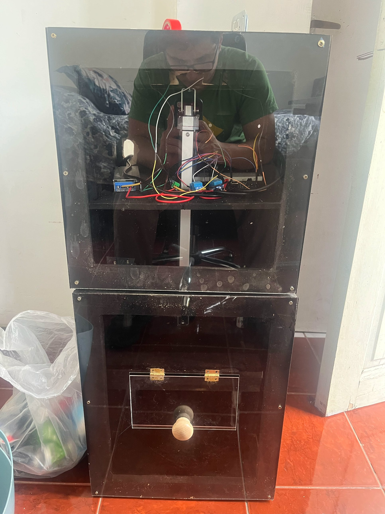
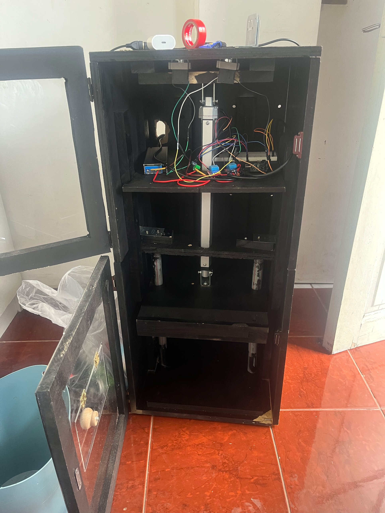
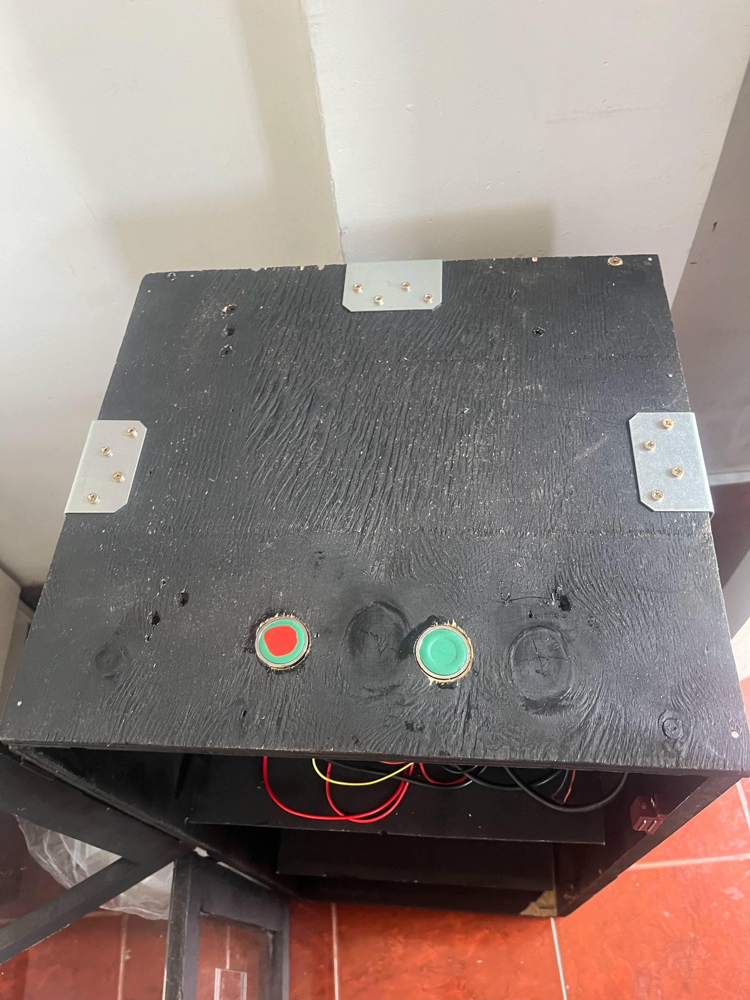

# Iteración 3 - Versión Final

## Información General

**Fecha:** noviembre 2026 (planos: 21-11-2026; repositorio definitivo: 22-11-2026)  
**Versión:** v3.0  
**Estado:** Prototipo final construido y funcionando, con limitación de carga por la estructura de madera  
**Avance asociado:** Avance #3 / entrega final

---

## Descripción

Versión final del prototipo: mueble de madera con el actuador lineal, ciclo automático de un toque, límite de fuerza por corriente y paro de emergencia. El circuito simulado en la v2 se llevó al montaje real, reemplazando el potenciómetro por un sensor de corriente y los LED por el actuador.

**Objetivos alcanzados:**
- ✅ Prototipo físico construido según planos (380 × 370 × 850 mm).
- ✅ Ciclo automático: la placa baja, se detiene y vuelve a subir con un solo toque.
- ✅ Paro de emergencia funcional en todo momento.
- ✅ Medición de corriente real y límite de fuerza para proteger la estructura.
- ⚠️ Capacidad limitada a 5 latas paradas por la resistencia de la madera.
- ⏳ Testing con usuarios: pendiente.

---

## Cambios Respecto a v2

### Hardware
1. **Sensor de corriente real (tipo ACS712) en lugar del potenciómetro.**
   - Razón: medir el esfuerzo verdadero del actuador.
   - Conexión: en serie con la línea V− de la fuente; su salida va a A0.
2. **Fuente de 12 V y 200 W (16,7 A).**
   - Razón: la fuente de la v1 no estaba pensada para compactar con carga.
3. **Pulsadores Ø30 en la tapa del mueble** (rojo = paro, verde = compactar).
4. **Cargador USB de 5 V** para el Arduino: el prototipo funciona sin computador.
5. **Sin sensor ultrasónico ni luz piloto:** no se montaron en el prototipo final.
6. **Escuadras de acero en el techo y el piso** (ver "Problemas encontrados").

### Software
- Programa `compactador_v3.ino` con máquina de estados: REPOSO, AVANCE, PAUSA, RETORNO y EMERGENCIA.
- Corte de la compactación a **3 A (≈ 700 N)**.
- Detección de los extremos del recorrido por la caída de corriente (fines de carrera internos del actuador), sin interruptores adicionales.
- Se ignora el pico de corriente del arranque y se confirma cada condición durante un tiempo mínimo.
- Pruebas de la lógica en un PC (`software/pruebas_pc/`): 5 escenarios correctos.

### Diseño mecánico
- Mueble de madera en 2 módulos atornillados, puertas de acrílico, puerta de carga de 200 × 150 mm.
- Placa compactadora de madera de 50 mm guiada por 2 tubos de Ø32.
- Actuador colgado de una viga con un perno de Ø8 (se saca en minutos para reparación).

---

## Fotos del Prototipo Final

Prototipo terminado: `hardware/fotos/` (9 fotos).

| Cerrado | Abierto | Tapa reforzada |
|---|---|---|
|  |  |  |

### Proceso de integración (`v3_fotos_proceso/`)

| Archivo | Contenido |
|---|---|
| `v3p_01_circuito_pruebas_sobre_mueble.jpg` | Circuito completo probado sobre el mueble antes de integrarlo: Arduino, relés, fuente, sensor de corriente y pulsadores de prueba |
| `v3p_02_circuito_pruebas_lateral.jpg` | El mismo montaje de pruebas, vista lateral |
| `v3p_03_mueble_pruebas_angulo_1.jpg` | Mueble con el circuito de pruebas sobre la tapa |
| `v3p_04_mueble_pruebas_angulo_2.jpg` | Mueble con el circuito de pruebas, otro ángulo |
| `v3p_05_tapa_botones_antes_refuerzo.jpg` | Tapa con los pulsadores Ø30 **antes** de agregar las escuadras de acero |

---

## Problemas encontrados

Los problemas de esta iteración fueron **principalmente de hardware**: el material de la estructura resistió poco.

1. **La estructura de madera cedía sobre ≈ 700 N.**
   - Descripción: cuando la corriente del actuador superaba los **3 A**, la fuerza (≈ 700 N) excedía lo que soportaba el mueble y este tendía a romperse, sobre todo en el techo (donde cuelga el actuador) y en el piso (donde se apoyan las latas).
   - Causa: el actuador empuja la placa hacia abajo y, con la misma fuerza, empuja el techo hacia arriba; las uniones atornilladas de madera no resisten esa carga.
   - Solución: **escuadras de acero** en el techo y el piso, y **corte por corriente a 3 A** en el programa.
2. **Capacidad limitada a 5 latas paradas.**
   - Descripción: con más de 5 latas paradas, la corriente necesaria superaba los 3 A.
   - Solución: el prototipo queda limitado a **máximo 5 latas paradas** por ciclo.
3. **Las latas acostadas no se pueden compactar.**
   - Descripción: acostadas, las latas se vuelven más duras de aplastar y superan la resistencia del prototipo.
   - Solución: en esta versión **solo se usan latas paradas**.

Estimación de fuerza, explicación física y recomendaciones: `testing/reportes/pruebas_carga_v3.md`.

---

## Resultados Finales

### Funcionalidad
✅ Ciclo automático de un toque  
✅ Paro de emergencia con prioridad  
✅ Límite de fuerza por corriente (3 A ≈ 700 N)  
✅ Detección de fin de recorrido sin sensores adicionales  
✅ Funciona sin computador (cargador USB + fuente de 12 V)  
⚠️ Máximo 5 latas paradas; latas acostadas no permitidas  
⏳ Testing con 5 o más usuarios: pendiente

### Testing con usuarios
Pendiente. Protocolo y métricas propuestas en `testing/README.md`.

---

## Comparación de las tres versiones

| Aspecto | v1 | v2 | v3 |
|---|---|---|---|
| Control | Manual | Automático (simulado) | Automático (real) |
| Medición | Ninguna | Potenciómetro | Sensor de corriente |
| Estructura | Modelo de acero | Diseño en madera | Mueble de madera reforzado con escuadras de acero |
| Fuerza útil | No medida | — | ≈ 700 N (3 A) |
| Capacidad | — | — | 5 latas paradas |

---

## Lecciones aprendidas

### Técnicas
- **La corriente es una forma barata de medir fuerza.** En un motor DC son proporcionales; con un sensor de corriente se puede limitar la fuerza sin una celda de carga.
- **El eslabón más débil manda.** El actuador (1500 N) y la fuente (16,7 A) tenían capacidad de sobra; la madera definió el límite real del sistema.
- **Toda fuerza tiene su reacción.** La estructura que sostiene al actuador recibe la misma fuerza que las latas; hay que diseñarla para eso desde el principio.
- **Simular antes de construir** permitió probar la lógica sin arriesgar el actuador, pero los límites reales solo aparecieron en el prototipo físico.

### De proceso
- Probar el circuito completo sobre el mueble antes de integrarlo facilitó encontrar errores de cableado.
- Documentar cada falla (iteración 1) evitó repetirlas: los pines y reglas de seguridad se mantuvieron hasta la versión final.

---

## Trabajo futuro

- Marco o tirantes metálicos entre techo y piso para usar la fuerza completa del actuador.
- Celda de carga para medir la fuerza real y calibrar el modelo fuerza-corriente.
- Microinterruptor en la puerta de carga (el ciclo solo con la puerta cerrada).
- Placa perforada soldada, fusible e interruptor general en la línea de 12 V.
- Testing con usuarios de la comunidad UAI.
