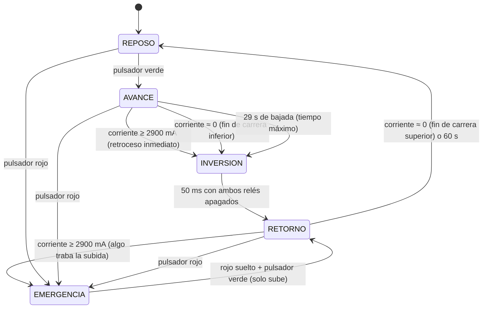

# Código fuente (v3.0)

## Archivos

| Archivo | Función |
|---|---|
| `compactador_v3/compactador_v3.ino` | **Código oficial.** Ciclo automático con un toque: baja y, al llegar al umbral de 2900 mA (2,9 A ≈ 665 N) o al fin de carrera, retrocede de inmediato. Paro de emergencia en todo momento |
| `diagnostico/diagnostico.ino` | Prueba por separado los relés, los pulsadores y el sensor de corriente (Monitor Serie a 9600 baudios) |

Cada programa está en su propia carpeta porque Arduino IDE exige que el archivo `.ino` esté dentro de una carpeta con su mismo nombre.

El programa de la v1 (control manual mientras se mantiene presionado cada botón) se conserva en `iteraciones/iteracion_1/codigo/main/main.ino`.

---

## Tabla de pines (v3.0)

| Pin Arduino | Conectado a | Modo en el código |
|---|---|---|
| 6 | Pulsador verde Ø30, COMPACTAR (otro borne a GND) | `INPUT_PULLUP` |
| 3 | Pulsador rojo Ø30, PARO DE EMERGENCIA (otro borne a GND) | `INPUT_PULLUP` |
| 4 | IN del relé 1 (AVANCE: la placa baja) | `OUTPUT` |
| 5 | IN del relé 2 (RETORNO: la placa sube) | `OUTPUT` |
| A0 | OUT del sensor de corriente (tipo ACS712) | `analogRead` |
| 5V / GND | Rieles de la protoboard (relés, sensor y pulsadores) | — |
| 2 | **No usar** (dañado en la iteración 1) | — |

Es la misma asignación de la simulación en Wokwi (`hardware/esquemas/simulacion_wokwi_v3.png`), donde un potenciómetro reemplaza al sensor de corriente y dos LED reemplazan al actuador.

Los módulos de relé se activan con **LOW** y se apagan con **HIGH** (`RELE_ENCENDIDO` y `RELE_APAGADO`).

---

## Funcionamiento de `compactador_v3.ino`

| Estado | Relé 1 | Relé 2 | Actuador | Sale del estado cuando… |
|---|---|---|---|---|
| REPOSO | Apagado | Apagado | Detenido arriba | Se presiona el verde |
| AVANCE | Encendido | Apagado | Baja y compacta | La corriente llega a **2900 mA**, cae casi a 0 o pasan **29 s** |
| INVERSION | Apagado | Apagado | Detenido | Pasan 50 ms (lo justo para que un relé se suelte antes de que cierre el otro) |
| RETORNO | Apagado | Encendido | Sube | La corriente cae casi a 0 (llegó arriba) o pasan 60 s |
| EMERGENCIA | Apagado | Apagado | Detenido | Se suelta el rojo y se presiona el verde: la placa solo sube |

### Umbral de 2900 mA y retroceso inmediato

- **Por qué 2,9 A y no 3 A.** Desde 3 A (≈ 700 N) la estructura de madera se daña. El umbral queda 0,1 A antes, como margen de seguridad.
- **Qué tan rápido reacciona.** En cada vuelta del programa (unos 3 ms) se mide la corriente. La primera lectura que llega a 2900 mA apaga el relé de avance en esa misma vuelta, sin esperar confirmación. A los 50 ms se activa el relé de retorno y la placa sube.
- **Resolución del sensor.** El Arduino mide el voltaje en escalones de 4,9 mV. Con el ACS712-20A (100 mV/A), cada escalón equivale a unos 49 mA, así que el corte ocurre entre ≈ 2,88 A y ≈ 2,93 A: siempre bajo 3 A. Con la versión 05B (185 mV/A) los escalones son de unos 26 mA.
- **El pico de arranque** de los primeros 400 ms no se considera: ocurre con la placa arriba y sin carga, cuando el motor recién parte.

### Por qué se usa la corriente

- **Para limitar la fuerza.** En un motor de corriente continua, la fuerza que hace es proporcional a la corriente que consume. Medir la corriente es una forma barata de "medir" la fuerza sin un sensor de fuerza. La estructura de madera se daña desde 3 A (≈ 700 N); por eso el umbral es 2,9 A (ver `testing/reportes/pruebas_carga_v3.md`).
- **Para saber dónde está la placa.** El actuador tiene fines de carrera internos que cortan el motor en los extremos del recorrido. Cuando eso pasa, la corriente cae casi a 0; el programa lo detecta y no necesita interruptores adicionales.

### Detalles que evitan errores

- La corriente alta actúa de inmediato (primera lectura sobre el umbral). La corriente baja debe mantenerse 800 ms seguidos antes de considerar que se llegó al fin de carrera, para que una lectura aislada no termine el ciclo por error.
- Antes de encender un relé siempre se apaga el otro. Si ambos quedaran activos, los dos cables del actuador quedarían en +12 V y el actuador no se movería.
- Después de un paro, el pulsador verde nunca hace bajar la placa: solo la sube a su posición segura.

---

## Parámetros que se pueden ajustar

| Constante | Valor | Qué controla |
|---|---|---|
| `SENSIBILIDAD_V_POR_A` | 0,100 | Sensibilidad del ACS712: 0,185 (versión 5 A), 0,100 (20 A) o 0,066 (30 A). **Verificar la versión del módulo** |
| `UMBRAL_CORRIENTE_MA` | 2900 | Umbral en miliamperes (2,9 A ≈ 665 N): al llegar, retroceso inmediato. **No subirlo:** desde 3000 mA la estructura se daña |
| `CORRIENTE_FIN_CARRERA_MA` | 300 | Bajo este valor (mA) se considera que el motor se detuvo en un extremo |
| `T_AVANCE_MAX_MS` | 29 000 | Tiempo máximo de bajada: **29 s** (valor usado en el prototipo). Si se cumple sin llegar a 2900 mA, la placa retrocede igual |
| `T_RETORNO_MAX_MS` | 60 000 | Tiempo máximo de subida (respaldo; normalmente se detiene antes, al llegar arriba) |
| `T_IGNORAR_ARRANQUE_MS` | 400 | Tiempo en que se ignora el pico de arranque |
| `T_INVERSION_MS` | 50 | Pausa entre apagar el avance y encender el retroceso |

---

## Reglas para evitar daños (aprendidas en las iteraciones)

- Verificar que los números de pin del código coincidan con el cableado **antes** de subirlo.
- Nunca configurar como `OUTPUT` un pin conectado a un pulsador.
- Hacer siempre la prueba en seco (sin 12 V) con `diagnostico.ino` después de cualquier cambio de cableado.
- No aumentar `UMBRAL_CORRIENTE_MA` sin reforzar antes la estructura.

## Estándares de código

- Comentarios en español que explican **qué** hace cada parte y **por qué**.
- Variables y funciones en `camelCase`; constantes en `UPPER_SNAKE_CASE`.
