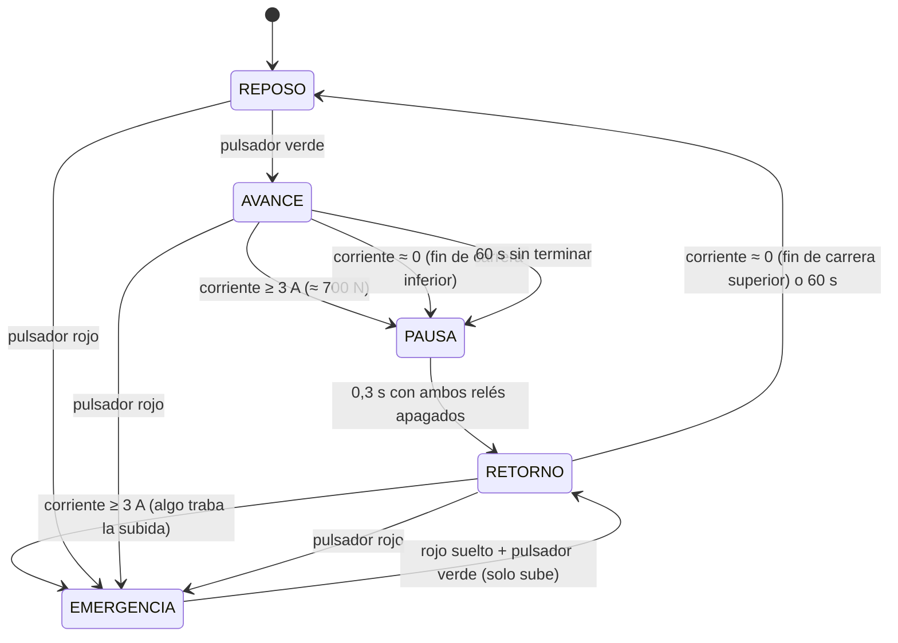

# Código fuente (v3.0)

## Archivos

| Archivo | Función |
|---|---|
| `compactador_v3/compactador_v3.ino` | **Programa definitivo.** Ciclo automático con un toque: baja, se detiene a 3 A (≈ 700 N) o en el fin de carrera, y vuelve a subir. Paro de emergencia en todo momento |
| `diagnostico/diagnostico.ino` | Prueba por separado los relés, los pulsadores y el sensor de corriente (Monitor Serie a 9600 baudios) |

Cada programa está en su propia carpeta porque Arduino IDE exige que el archivo `.ino` esté dentro de una carpeta con su mismo nombre.

El programa de la v1 (control manual mientras se mantiene presionado cada botón) se conserva en `iteraciones/iteracion_1/codigo/main/main.ino`.

---

## Tabla de pines (v3.0)

| Pin Arduino | Conectado a | Modo en el código |
|---|---|---|
| 6 | Pulsador verde Ø30, COMPACTAR (otro borne a GND) | `INPUT_PULLUP` |
| 3 | Pulsador rojo Ø30, PARO DE EMERGENCIA (otro borne a GND) | `INPUT_PULLUP` |
| 4 | IN del relé 1 (AVANCE: la placa baja) | `OUTPUT` |
| 5 | IN del relé 2 (RETORNO: la placa sube) | `OUTPUT` |
| A0 | OUT del sensor de corriente (tipo ACS712) | `analogRead` |
| 5V / GND | Rieles de la protoboard (relés, sensor y pulsadores) | — |
| 2 | **No usar** (dañado en la iteración 1) | — |

Es la misma asignación de la simulación en Wokwi (`hardware/esquemas/simulacion_wokwi_v3.png`), donde un potenciómetro reemplaza al sensor de corriente y dos LED reemplazan al actuador.

Los módulos de relé se activan con **LOW** y se apagan con **HIGH** (`RELE_ENCENDIDO` y `RELE_APAGADO`).

---

## Funcionamiento de `compactador_v3.ino`

| Estado | Relé 1 | Relé 2 | Actuador | Sale del estado cuando… |
|---|---|---|---|---|
| REPOSO | Apagado | Apagado | Detenido arriba | Se presiona el verde |
| AVANCE | Encendido | Apagado | Baja y compacta | La corriente llega a 3 A, cae casi a 0 o pasan 60 s |
| PAUSA | Apagado | Apagado | Detenido | Pasan 0,3 s (evita invertir el motor de golpe) |
| RETORNO | Apagado | Encendido | Sube | La corriente cae casi a 0 (llegó arriba) o pasan 60 s |
| EMERGENCIA | Apagado | Apagado | Detenido | Se suelta el rojo y se presiona el verde: la placa solo sube |

### Por qué se usa la corriente

- **Para limitar la fuerza.** En un motor de corriente continua, la fuerza que hace es proporcional a la corriente que consume. Medir la corriente es una forma barata de "medir" la fuerza sin un sensor de fuerza. El límite de 3 A (≈ 700 N) es el máximo que soportó la estructura de madera (ver `testing/reportes/pruebas_carga_v3.md`).
- **Para saber dónde está la placa.** El actuador tiene fines de carrera internos que cortan el motor en los extremos del recorrido. Cuando eso pasa, la corriente cae casi a 0; el programa lo detecta y no necesita interruptores adicionales.

### Detalles que evitan errores

- El pico de corriente de los primeros 0,6 s de cada arranque no se considera (un motor siempre consume más al partir).
- La corriente alta debe mantenerse 150 ms seguidos y la baja 800 ms seguidos antes de actuar, para que el ruido del motor no detenga el ciclo por error.
- Antes de encender un relé siempre se apaga el otro. Si ambos quedaran activos, los dos cables del actuador quedarían en +12 V.
- Después de un paro, el pulsador verde nunca hace bajar la placa: solo la sube a su posición segura.

---

## Parámetros que se pueden ajustar

| Constante | Valor | Qué controla |
|---|---|---|
| `SENSIBILIDAD_V_POR_A` | 0,100 | Sensibilidad del ACS712: 0,185 (versión 5 A), 0,100 (20 A) o 0,066 (30 A). **Verificar la versión del módulo** |
| `CORRIENTE_LIMITE_A` | 3,0 | Corriente máxima al compactar (≈ 700 N). No subirla con la estructura de madera actual |
| `CORRIENTE_FIN_CARRERA_A` | 0,30 | Bajo este valor se considera que el motor se detuvo en un extremo |
| `T_AVANCE_MAX_MS` / `T_RETORNO_MAX_MS` | 60 000 | Tiempo máximo de cada movimiento (300 mm a 6 mm/s = 50 s) |
| `T_IGNORAR_ARRANQUE_MS` | 600 | Tiempo en que se ignora el pico de arranque |

---

## Reglas para evitar daños (aprendidas en las iteraciones)

- Verificar que los números de pin del código coincidan con el cableado **antes** de subirlo.
- Nunca configurar como `OUTPUT` un pin conectado a un pulsador.
- Hacer siempre la prueba en seco (sin 12 V) con `diagnostico.ino` después de cualquier cambio de cableado.
- No aumentar `CORRIENTE_LIMITE_A` sin reforzar antes la estructura.

## Estándares de código

- Comentarios en español que explican **qué** hace cada parte y **por qué**.
- Variables y funciones en `camelCase`; constantes en `UPPER_SNAKE_CASE`.
