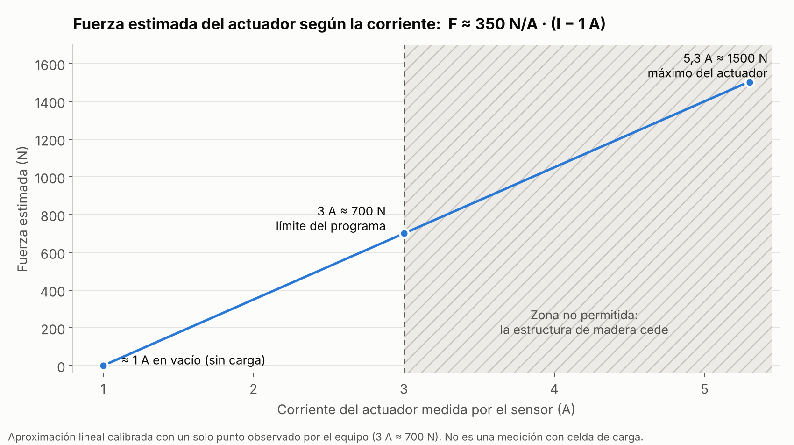

# Pruebas de carga y limitación del prototipo v3

**Fecha:** noviembre 2026  
**Prototipo:** v3.0, mueble de madera de 380 × 370 × 850 mm con actuador lineal de 12 V (1500 N máx.)  
**Responsables:** equipo del proyecto (pruebas en el prototipo real)

---

## 1. Resumen

| Resultado | Valor |
|---|---|
| Latas por ciclo | **Máximo 5, siempre paradas** |
| Latas acostadas | **No permitidas** en esta versión |
| Corriente máxima permitida por el programa | **3 A** |
| Fuerza estimada a 3 A | **≈ 700 N** (equivale al peso de unos 71 kg) |
| Causa del límite | La **estructura de madera**, no el actuador ni la fuente |
| Medida correctiva | Escuadras de acero en el techo y en el piso, y corte por corriente en el programa |

El actuador puede empujar hasta 1500 N y la fuente puede entregar hasta 16,7 A, pero el mueble de madera no resiste esa fuerza. Por eso el programa detiene la compactación cuando la corriente llega a 3 A.

---

## 2. Qué se observó

1. **Sobre 3 A la estructura se tendía a romper.** Cuando la corriente del actuador superaba los 3 A, la fuerza también superaba lo que soportaba el mueble: el techo (donde cuelga el actuador) y el piso (donde se apoyan las latas) comenzaban a ceder.
2. **Con más de 5 latas paradas se superaban los 3 A.** Al aumentar la cantidad de latas, la corriente necesaria para compactarlas pasaba el límite. Por eso el prototipo quedó limitado a un máximo de 5 latas paradas por ciclo.
3. **Las latas acostadas no se pueden compactar.** Acostadas, las latas se vuelven más duras de aplastar y superan la resistencia del prototipo.
4. **La mayoría de los problemas fueron de hardware.** El software y la electrónica funcionaron; el factor limitante fue la poca resistencia del material de la estructura.

---

## 3. Estimación de la fuerza a partir de la corriente

### Por qué se puede estimar la fuerza con la corriente
El actuador es un motor de corriente continua que mueve un tornillo. En este tipo de motor, la fuerza que entrega crece en proporción a la corriente que consume: si debe empujar más, "pide" más corriente a la fuente. Una parte de la corriente se gasta siempre en mover el motor y el tornillo aunque no haya carga.

Por eso se usa un modelo lineal:

$$F \approx k\,(I - I_0)$$

- $I_0 \approx 1\ \text{A}$: corriente en vacío, cuando el actuador se mueve sin empujar nada.
- $k$: cuántos newtons aporta cada ampere adicional.

### Cálculo de $k$
El equipo estimó que con **3 A** el actuador ejercía **≈ 700 N**:

$$k = \frac{700\ \text{N}}{3\ \text{A} - 1\ \text{A}} = 350\ \text{N/A}$$

$$\boxed{F \approx 350\ \tfrac{\text{N}}{\text{A}}\,(I - 1\ \text{A})}$$

### Comprobación con la ficha del actuador
Con este modelo, la fuerza máxima del fabricante (1500 N) correspondería a:

$$I = 1\ \text{A} + \frac{1500\ \text{N}}{350\ \text{N/A}} \approx 5{,}3\ \text{A}$$

Es un valor cercano al rango de 3 a 5 A que se estimó en la iteración 1 para este actuador a plena carga, así que el modelo es coherente con la ficha.

ℹ **[INFORMACIÓN COMPLEMENTARIA AGREGADA] Comprobación por potencia.** A 3 A la fuente entrega $P = 12\ \text{V} \cdot 3\ \text{A} = 36\ \text{W}$. Empujando 700 N a una velocidad de 4 a 6 mm/s, el actuador entrega $P = F \cdot v \approx 2{,}8$ a $4{,}2\ \text{W}$. Eso da un rendimiento total cercano al 8–12 %, que es bajo pero esperable en un actuador con reductora y tornillo, donde gran parte de la energía se pierde en roce. La estimación de 700 N es, por lo tanto, físicamente razonable.

### Tabla (ver `testing/datos/estimacion_fuerza_corriente.csv`)

| Corriente (A) | Fuerza estimada (N) | Equivale al peso de | Situación |
|---|---|---|---|
| 1,0 | 0 | 0 kg | Actuador en vacío |
| 2,0 | 350 | 36 kg | Permitido |
| 2,5 | 525 | 54 kg | Permitido |
| **3,0** | **700** | **71 kg** | **Límite del programa** |
| 4,0 | 1050 | 107 kg | No permitido: la estructura cede |
| 5,3 | 1500 | 153 kg | Máximo del actuador |

**Limitación de la estimación:** se calibró con un solo punto observado (3 A ≈ 700 N) y con una corriente en vacío aproximada. Para medir la fuerza real habría que usar una celda de carga (por ejemplo, con un módulo HX711) bajo la placa compactadora.

---

## 4. Por qué falla la estructura

ℹ **[INFORMACIÓN COMPLEMENTARIA AGREGADA]** Explicación física de lo observado:

- **Acción y reacción.** El actuador cuelga de la viga del techo (pieza P4 de los planos) y empuja la placa hacia abajo. Con la misma fuerza con que aplasta las latas (≈ 700 N), empuja el techo hacia arriba. Al mismo tiempo, las latas transmiten esos 700 N al piso.
- **El mueble queda "estirado".** El techo tiende a subir y el piso a bajar, así que las paredes laterales y la unión atornillada entre los dos módulos (a 470 mm de altura) trabajan a tracción.
- **Los puntos débiles son las uniones.** En la madera, los tornillos sostienen poco cuando se tira de ellos en la dirección del tornillo, y las tablas delgadas se flectan. Por eso el techo y el piso son los primeros en ceder.
- **Por qué sirven las escuadras de acero.** Las escuadras unen el techo y el piso con las paredes y reparten la fuerza en varios tornillos y en una superficie mayor. Así la carga no se concentra en unos pocos tornillos.

ℹ **[INFORMACIÓN COMPLEMENTARIA AGREGADA] Por qué cuesta más aplastar una lata acostada.** Parada, la pared de la lata (muy delgada) se pliega como un acordeón y la placa solo debe vencer ese pliegue. Acostada, la placa debe aplastar también el fondo abombado y el borde superior, que son las partes más rígidas de la lata, y la fuerza necesaria sube por sobre lo que resiste el mueble.

---

## 5. Medidas tomadas

| Medida | Dónde | Efecto |
|---|---|---|
| Escuadras de acero | Techo y piso del mueble (fotos `hardware/fotos/v3_08_tapa_escuadras_superior.jpg` y `v3_09_tapa_escuadras_angulo.jpg`) | Reparten la fuerza y evitan que se suelten las uniones |
| Corte por corriente a 3 A | `software/src/compactador_v3/compactador_v3.ino` (`CORRIENTE_LIMITE_A`) | El actuador nunca empuja más de ≈ 700 N |
| Máximo 5 latas paradas | Manual de operación (`software/docs/README.md`) | La compactación termina antes de llegar al límite de la estructura |
| Prohibición de latas acostadas | Manual de operación | Evita cargas que superan la resistencia del prototipo |

---

## 6. Recomendaciones para una versión siguiente

- Construir el marco que recibe la fuerza (techo, piso y uniones) en **acero o aluminio**, o en madera de mayor espesor con pernos pasantes en vez de tornillos, para aprovechar los 1500 N del actuador.
- Unir el techo y el piso con **tirantes metálicos** (por ejemplo, varillas roscadas) para que la fuerza del actuador no pase por las paredes de madera.
- Medir la fuerza real con una **celda de carga** y recalibrar el modelo $F(I)$ con varios puntos.
- Repetir la prueba de cantidad de latas después del refuerzo, subiendo el límite de corriente en pasos de 0,25 A.
